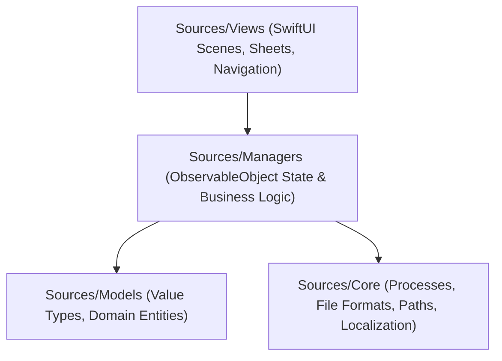

# Architecture & Technical Design

**NXNative Hub** is a native macOS application developed with SwiftUI (targeting macOS 14+ on Apple Silicon). It does not transpile games directly; instead, it coordinates the upstream `nxnative` toolchain, parses runtime specifications, manages process execution, and presents a cohesive interface for configuration and library organization.

---

## Architectural Layers

The codebase adheres to a strict downward dependency hierarchy:
`Sources/Views` → `Sources/Managers` → `Sources/Models` & `Sources/Core`.



| Layer | Responsibility | Key Types |
|---|---|---|
| **App** (`Sources/App`) | Application lifecycle, scene declarations, top-level commands, menu actions | `NXNativeHubApp`, `AppRouter`, `AppCommands`, `GameActions` |
| **Views** (`Sources/Views`) | Declarative SwiftUI views, sheets, forms, and status inspectors | `ContentView`, `LibraryView`, `BuilderView`, `ImportView`, `GameSettingsSheet`, `GameStatusSheet`, `SettingsView` |
| **Managers** (`Sources/Managers`) | Core application state, business logic, asynchronous coordination (`ObservableObject`) | `GameLibraryManager`, `BuildManager`, `ImportBatchManager`, `UpdateManager`, `ActiveBuildMonitor`, `GameSettingsModel`, `SetupChecker`, `AppPreferences`, `GameDiagnostics` |
| **Models** (`Sources/Models`) | Immutable models, data structures, status evaluation | `InstalledGame`, `TargetPlatform`, `ProfileDatabase`, `GameMetaDetector`, `GameUpdateStatus` |
| **Core** (`Sources/Core`) | Process execution, parsing, filesystem paths, localization, update calculations | `NXPaths`, `CommandRunner`, `StreamingProcess`, `BuildEvent`, `BuildFailureTracker`, `LiveLogWriter`, `EnvFile`, `LauncherSettingsList`, `SavedChoices`, `ProdKeysFile`, `Notifier`, `SwitchTitleID`, `GameUpdateChecker`, `tr()` |

---

## State Management & Concurrency

- **Global Availability**: Critical managers are instantiated once as `@StateObject`s in `NXNativeHubApp` and injected into the SwiftUI hierarchy via `.environmentObject`.
- **Command & Menu Parity**: `AppCommands` accesses the exact same manager instances as the view hierarchy, ensuring that keyboard shortcuts, menu bar items, and UI buttons trigger identical behaviors.
- **Routing & Presentation**: `AppRouter` isolates view state (selected sidebar tab, active game ID, open sheets).
- **Asynchronous Execution**: Heavy I/O, process streaming, and git inspections execute on background queues via `DispatchQueue.global(qos:)`. UI updates are published strictly on the main actor/thread.

---

## Process Orchestration

All external processes are executed with explicit argument arrays—never interpolated through shell strings—preventing injection risks and argument misparsing.

| Utility | Caller | Execution Bridge | Role |
|---|---|---|---|
| `scripts/build_ipa_from_nsp.py` | `BuildManager`, `ImportBatchManager` | `StreamingProcess` | Compiles game dump to `.app` bundle, reporting `--progress json` events |
| `git`, `pip`, `dotnet` | `UpdateManager` | `CommandRunner` | Fetches updates and installs dependency packages |
| `ps` | `ActiveBuildMonitor` | `CommandRunner` | Polls active processes every 2.5 seconds to track background or Terminal-initiated builds |
| `xcodebuild`, `xcrun metal`, `brew` | `SetupChecker` | `CommandRunner` | Verifies and provisions developer toolchain components |
| `ditto` | `SaveGameImporter` | `CommandRunner` | Safely extracts save archives preserving attributes |
| `scripts/bug_report.py` | `GameDiagnostics` | `CommandRunner` | Bundles game logs and system specs into diagnostic zips |

---

## Game Configuration Architecture

Modern `nxnative` builds include a dynamic manifest (`Contents/Resources/dm/launcher.json`) declaring supported options, sections, data types, and default values.

```
Order of Evaluation:
[Launch Arguments / Environment] → [~/Library/.../env.txt] → [Bundle dm/env.txt] → [User Defaults (Saved Choices)] → [Tested Defaults]
```

1. **Manifest Parsing (`LauncherSettingsList`)**: Dynamically decodes `launcher.json` (Schema 1) without requiring recompilation of NXNative Hub when new engine variables are introduced.
2. **Preference Persistence (`SavedChoices`)**: Saves deviations from defaults to the game bundle's preferences domain (`org.nxnative.<titleID>`). This keeps the base configuration clean and ensures identical behavior whether launched from NXNative Hub or standalone.
3. **Start Window Bypass**:
   - Setting `DM_LAUNCHER=0` or passing `--no-launcher` skips the game's internal settings dialog, starting the game immediately.
   - NXNative Hub exposes this via a global preference and per-game overrides, while respecting the Option-key (`⌥`) escape hatch.
4. **Legacy Fallback**: Games compiled without `launcher.json` fall back to writing explicit key-value pairs directly into `~/Library/Application Support/nxnative/<TitleID>/env.txt`.

---

## Recompilation Intelligence (`GameUpdateChecker`)

Installed titles are continuously evaluated against upstream changes:
- **Profile Matching**: Compares the local build's commit against the latest nxnative game profiles.
- **Shader Chain Versioning**: Detects whether the active shader chain has advanced beyond the compiled game's shader generation.
- **Engine Advancements**: Highlights upstream core commits that introduce stability or performance fixes.

---

## Filesystem Layout & Storage

| Path | Purpose | Handled By |
|---|---|---|
| `~/NXNative/nxnative` | Upstream engine repository, profiles, and Python venv | `NXPaths.repoPath`, `UpdateManager` |
| `~/NXNative/Games` | Installed native macOS application bundles | `GameLibraryManager` |
| `~/NXNative/Import` | Incoming directory for batch processing | `ImportBatchManager` |
| `~/NXNative/build_live.log` | Real-time log capture of current build operations | `LiveLogWriter` |
| `~/Library/Application Support/nxnative/<TitleID>/` | `env.txt` and save directories (`save/`, `save_backup_<date>`) | `GameSettingsModel`, `SaveGameImporter` |
| `~/Library/Preferences/org.nxnative.<TitleID>.plist` | Saved runtime choices (`launcher.*`) | `SavedChoices` |
| `~/Library/Logs/nxnative/<TitleID>.log` | Execution logs of previous game sessions | `GameDiagnostics` |

---

## Localization System

Localization uses a zero-configuration inline model via `tr("German", "English")` defined in `Sources/Core/Localization.swift`. Language switches trigger a non-destructive redraw of the root view tree (`ContentView.id(currentLanguage)`), ensuring instantaneous language updates across all views and dialogs.
