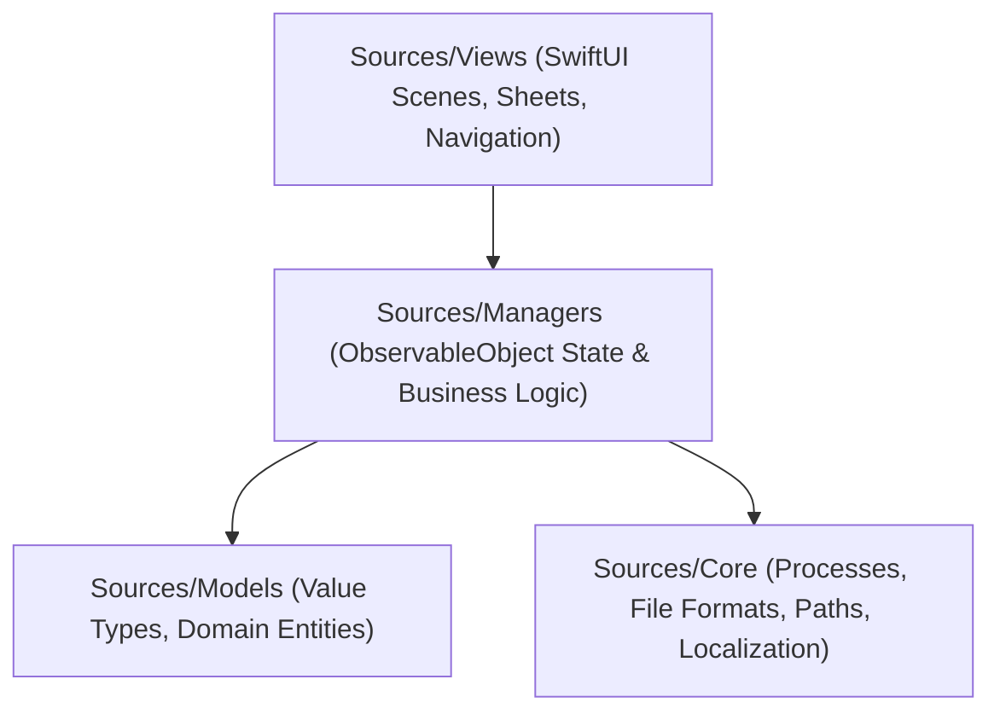
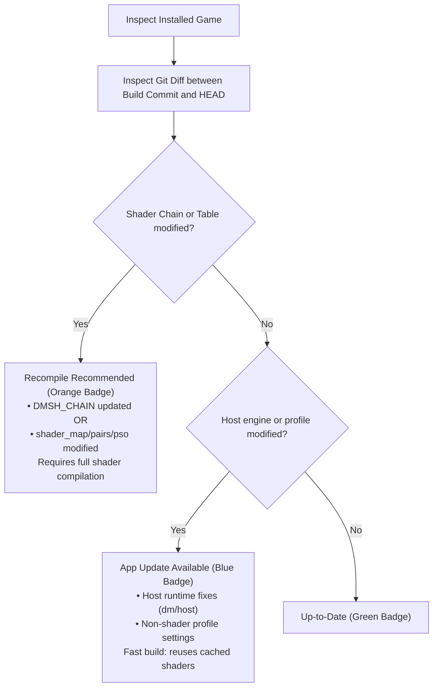

# Architecture & Technical Design

**NXNative Hub** is a native macOS application developed with SwiftUI (targeting macOS 14+ on Apple Silicon). It does not transpile games directly; instead, it coordinates the upstream `nxnative` toolchain, parses runtime specifications, manages process execution, and presents a cohesive interface for configuration and library organization.

---

## Architectural Layers

The codebase adheres to a strict downward dependency hierarchy:
`Sources/Views` → `Sources/Managers` → `Sources/Models` & `Sources/Core`.



| Layer | Responsibility | Key Types |
|---|---|---|
| **App** (`Sources/App`) | Application lifecycle, scene declarations, top-level commands, menu actions | `NXNativeHubApp`, `AppRouter`, `AppCommands`, `GameActions` |
| **Views** (`Sources/Views`) | Declarative SwiftUI views, sheets, forms, and status inspectors | `ContentView`, `LibraryView`, `BuilderView`, `ImportView`, `GameSettingsSheet`, `GameStatusSheet`, `SettingsView` |
| **Managers** (`Sources/Managers`) | Core application state, business logic, asynchronous coordination (`ObservableObject`) | `GameLibraryManager`, `BuildManager`, `ImportBatchManager`, `UpdateManager`, `ActiveBuildMonitor`, `GameSettingsModel`, `SetupChecker`, `AppPreferences`, `GameDiagnostics` |
| **Models** (`Sources/Models`) | Immutable models, data structures, status evaluation | `InstalledGame`, `TargetPlatform`, `ProfileDatabase`, `GameMetaDetector`, `GameUpdateStatus` |
| **Core** (`Sources/Core`) | Process execution, parsing, filesystem paths, localization, update calculations | `NXPaths`, `CommandRunner`, `StreamingProcess`, `BuildEvent`, `BuildTimeline`, `BuildFailureTracker`, `LiveLogWriter`, `EnvFile`, `LauncherSettingsList`, `SavedChoices`, `ProdKeysFile`, `Notifier`, `SwitchTitleID`, `NUPReader`, `DumpFolderReader`, `GameSourceKind`, `GameUpdateChecker`, `GameSourceLocator`, `BuildWorkFolder`, `tr()` |

---

## State Management & Concurrency

- **Global Availability**: Critical managers are instantiated once as `@StateObject`s in `NXNativeHubApp` and injected into the SwiftUI hierarchy via `.environmentObject`.
- **Command & Menu Parity**: `AppCommands` accesses the exact same manager instances as the view hierarchy, ensuring that keyboard shortcuts, menu bar items, and UI buttons trigger identical behaviors.
- **Routing & Presentation**: `AppRouter` isolates view state (selected sidebar tab, active game ID, open sheets).
- **Asynchronous Execution**: Heavy I/O, process streaming, and git inspections execute on background queues via `DispatchQueue.global(qos:)`. UI updates are published strictly on the main actor/thread.

---

## Process Orchestration

All external processes are executed with explicit argument arrays—never interpolated through shell strings—preventing injection risks and argument misparsing.

| Utility | Caller | Execution Bridge | Role |
|---|---|---|---|
| `scripts/build_ipa_from_nsp.py` | `BuildManager`, `ImportBatchManager` | `StreamingProcess` | Compiles game dump to `.app` bundle, reporting `--progress json` events |
| `git`, `pip` | `UpdateManager` | `CommandRunner` | Fetches updates and installs dependency packages |
| `ps` | `ActiveBuildMonitor` | `CommandRunner` | Polls active processes every 2.5 seconds to track background or Terminal-initiated builds |
| `lsof` | `ActiveBuildMonitor` | `CommandRunner` | Finds the file a Terminal build writes its output to (`> file` or `\| tee file`); `LogFollower` reads it incrementally into a `BuildTimeline` for the live log |
| `xcodebuild`, `xcrun metal`, `brew` | `SetupChecker` | `CommandRunner` | Verifies and provisions developer toolchain components |
| `ditto` | `SaveGameImporter` | `CommandRunner` | Safely extracts save archives preserving attributes |
| `scripts/bug_report.py` | `GameDiagnostics` | `CommandRunner` | Bundles game logs and system specs into diagnostic zips |

---

## Game Configuration Architecture

Modern `nxnative` builds include a dynamic manifest (`Contents/Resources/dm/launcher.json`) declaring supported options, sections, data types, and default values.

```
Order of Evaluation:
[Launch Arguments / Environment] → [~/Library/.../env.txt] → [Bundle dm/env.txt] → [User Defaults (Saved Choices)] → [Tested Defaults]
```

1. **Manifest Parsing (`LauncherSettingsList`)**: Dynamically decodes `launcher.json` (Schema 1) without requiring recompilation of NXNative Hub when new engine variables are introduced.
2. **Preference Persistence (`SavedChoices`)**: Saves deviations from defaults to the game bundle's preferences domain (`org.nxnative.<titleID>`). This keeps the base configuration clean and ensures identical behavior whether launched from NXNative Hub or standalone.
3. **Start Window Bypass**:
   - Setting `DM_LAUNCHER=0` or passing `--no-launcher` skips the game's internal settings dialog, starting the game immediately.
   - NXNative Hub exposes this via a global preference and per-game overrides, while respecting the Option-key (`⌥`) escape hatch.
4. **Legacy Fallback**: Games compiled without `launcher.json` fall back to writing explicit key-value pairs directly into `~/Library/Application Support/nxnative/<TitleID>/env.txt`.

---

## Recompilation & Update Intelligence

Installed titles are continuously evaluated against upstream changes to balance cutting-edge engine fixes against compilation time:



### 1. Decision Engine (`GameUpdateChecker`)
- **Shader Recompilation vs. Fast App Update**:
  - **Recompilation Recommended (`.recompileRecommended`)**: Triggered when the upstream `DMSH_CHAIN` version (`dm/gfx/nvn/dmsh_chain.h`) increments or when game profile shader tables are altered (`shader_map.tsv`, `shader_pairs.tsv`, `c1_full.tsv`, `cb_extent.tsv`, `pso_manifest.tsv`, `pso_pairs.tsv`, `shader_facts.tsv`). Full GPU shader translation and pipeline generation will take place.
  - **App Update Available (`.appUpdateAvailable`)**: Triggered when upstream changes affect the host runtime (`dm/host/`), launcher, memory mappings, or non-shader profile definitions (such as `game.tsv` or documentation). In this state, existing compiled shaders remain 100% valid. The toolchain skips shader recompilation, rebuilding only the `dmhost` executable and repackaging the macOS bundle in seconds (~5–15s).
  - **Up-to-Date (`.upToDate`)**: The compiled game matches the latest upstream commit and shader generation.

### 2. Automated Source Locator (`GameSourceLocator`)
Updating or recompiling a game requires access to the original source package and any existing intermediate caches. `GameSourceLocator` eliminates manual folder picker interactions:
- **Source Resolution Order**:
  1. Internal `.key` manifest inside the application bundle (`Contents/Resources/dm/.key`).
  2. Incoming directory `~/NXNative/Import/` for matching `.nsp`, `.xci`, or `.nup` files.
  3. Parent directory of the installed application bundle.
  4. User fallback prompt if sources have been relocated or external media is unplugged.
- **Cache Resolution**:
  - Automatically identifies whether an intermediate `<titleID>_build` directory exists alongside the source file or in historical build locations.
- **Direct Build Dispatch (`GameUpdateAction`)**:
  - Programmatically initializes `BuildManager` with resolved paths, passes the correct update mode, and displays live build logs directly from the Library row, Status inspector, or Settings sheet without requiring navigation away from the current view.

---

## Storage Strategy & Cache Lifecycle (`BuildWorkFolder`)

Compiling Switch titles into native macOS applications involves intermediate work directories that can grow rapidly:

```
Permanent Archive (Retain)            Ephemeral Cache (Safe to Trash)           Final Executable (Keep)
  ~/NXNative/Import/<TitleID>.nsp  ──►   <SourceDir>/<TitleID>_build/   ──►   ~/NXNative/Games/<Game>.app
      (~1 GB – ~15 GB)                      (~8 GB – ~105 GB)                     (~1 GB – ~15 GB)
```

### 1. NSP vs. Build Folder Lifecycle
- **The Source of Truth**: The upstream tool `scripts/build_ipa_from_nsp.py` strictly requires game package files (`.nsp`, `.xci`, `.nup`, or dump folders) to read PFS0 headers and content metadata (`no game package with a readable content meta`). Therefore, original package files are the permanent source of truth and should be retained for future updates.
- **Intermediate Build Folder (`<titleID>_build`)**: During build, the toolchain unpacks RomFS/ExeFS partitions, compiles intermediate Metal shader libraries, and stores uncompressed assets. For large titles (e.g., *The Legend of Zelda* series), this directory can easily consume 80 GB to 100+ GB of disk space.

### 2. Non-Destructive Storage Reclamation
- **Safe Trashing**: NXNative Hub never executes destructive filesystem commands (`rm -rf`). Instead, `BuildWorkFolder.trashFolder(at:)` uses `FileManager.default.trashItem(at:resultingItemURL:)` to move `<titleID>_build` to the macOS Trash (`~/.Trash`). This ensures users can restore files if needed.
- **Post-Build Cleanup Banner**: Upon build completion, both `BuilderView` and `LiveLogSheet` calculate the exact disk space consumed by `<titleID>_build` and present a prominent one-click cleanup banner (`"Trash Build Folder to Free X GB"`).
- **Status Sheet Maintenance**: The Game Status inspector (`GameStatusSheet`) inspects disk usage for installed games, reports whether a cached `<titleID>_build` folder exists, displays its formatted size, and provides a direct button to trash it while preserving the permanent `.nsp` archive.
- **Subsequent Updates Without Cache**: If `<titleID>_build` has been trashed to reclaim space, subsequent App Updates or Recompilations seamlessly unpack the retained `.nsp` again without errors.

---

## Filesystem Layout & Storage

| Path | Purpose | Handled By |
|---|---|---|
| `~/NXNative/nxnative` | Upstream engine repository, profiles, and Python venv | `NXPaths.repoPath`, `UpdateManager` |
| `~/NXNative/Games` | Installed native macOS application bundles | `GameLibraryManager` |
| `~/NXNative/Import` | Incoming directory for batch processing and retained source archives | `ImportBatchManager`, `GameSourceLocator` |
| `<SourceDir>/<TitleID>_build/` | Ephemeral build directory & intermediate shader cache (safe to trash post-build) | `BuildWorkFolder`, `BuildManager` |
| `~/NXNative/build_live.log` | Real-time log capture of current build operations | `LiveLogWriter` |
| `~/Library/Application Support/nxnative/<TitleID>/` | `env.txt` and save directories (`save/`, `save_backup_<date>`) | `GameSettingsModel`, `SaveGameImporter` |
| `~/NXNative/SaveSync` | Save sync state (`state.json`) and journals of running syncs (`pending/`) | `SaveSyncManager`, `SaveSyncEngine` |
| `~/NXNative/SaveBackups/<TitleID>/<kind>` | Verified backups of both sides before every sync, the last 10 of each side | `SaveSyncEngine` |
| `~/Library/Preferences/org.nxnative.<TitleID>.plist` | Saved runtime choices (`launcher.*`) | `SavedChoices` |
| `~/Library/Logs/nxnative/<TitleID>.log` | Execution logs of previous game sessions | `GameDiagnostics` |

---

## Localization System

Localization uses a zero-configuration inline model via `tr("German", "English")` defined in `Sources/Core/Localization.swift`. Language switches trigger a non-destructive redraw of the root view tree (`ContentView.id(currentLanguage)`), ensuring instantaneous language updates across all views and dialogs.
